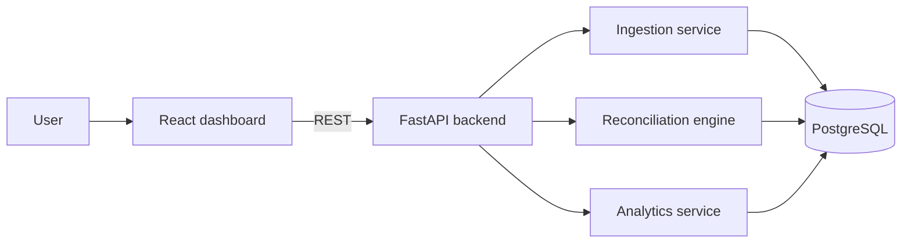

# ReconX

**Financial Reconciliation & Payment Failure Detection System**

ReconX compares transactions from an internal payment system with the report from an external payment provider. It finds discrepancies, identifies failed and pending payments, and produces reconciliation reports.
---

## 1. The problem

A digital wallet company processes payments through an external payment gateway. When a customer pays NPR 5,000:

1. The wallet records the transaction.
2. The gateway processes it.
3. The gateway later reports it in a transaction or settlement report.

These records don't always agree:

- The wallet says **SUCCESS**, but the provider says **FAILED**.
- The wallet records NPR 5,000, but the provider reports NPR 4,500.
- The provider processed a payment that the wallet has no record of.
- The same transaction appears twice in the provider report.
- A transaction stays **PENDING** for too long.

Each of these is a financial discrepancy that someone has to investigate. ReconX finds them automatically.

## 2. How it works

1. **Upload** the internal transactions CSV.
2. **Upload** the provider transactions CSV.
3. **Validate** the files: required columns, references, amounts, currencies and statuses.
4. **Reconcile**: match records by `reference` and compare their details.
5. **Detect** missing records, duplicates, and amount, currency or status mismatches.
6. **Report**: show statistics and the financial impact, and export the results as CSV.

## 3. Architecture



The dashboard only talks to the API. All business logic is in `app/services/`.

## 4. Features

### Module 1: Transaction data management
- Upload the internal and provider CSV files.
- Validate each file and store its rows in PostgreSQL.

### Module 2: Reconciliation engine
Records are matched on `reference`. For each reference the engine:

1. Checks whether the reference appears more than once in the provider file.
2. Compares the amount, currency and status.
3. Flags references that exist on only one side.

| Category | Meaning |
|---|---|
| `MATCHED` | Both systems agree |
| `AMOUNT_MISMATCH` | Amounts differ |
| `STATUS_MISMATCH` | Statuses differ |
| `CURRENCY_MISMATCH` | Currencies differ |
| `MISSING_PROVIDER` | No provider record |
| `MISSING_INTERNAL` | No internal record |
| `DUPLICATE` | More than one provider record |
| `PENDING` | Both sides agree, but the payment is still pending |

A single result can carry **several flags**, for example `AMOUNT_MISMATCH` and `STATUS_MISMATCH` together. A result is `MATCHED` only when it has no flags.

### Module 3: Payment failure detection
**Reconciliation status** and **payment outcome** are two separate things. A failed payment that both systems agree on is reconciled correctly, but it is still a failed payment.

| Reference | Internal | Provider | Reconciliation | Payment outcome |
|---|---|---|---|---|
| TXN-101 | SUCCESS | SUCCESS | MATCHED | SUCCESS |
| TXN-102 | SUCCESS | FAILED | STATUS_MISMATCH | Needs investigation |
| TXN-103 | FAILED | FAILED | MATCHED | FAILED |
| TXN-104 | PENDING | PENDING | PENDING | PENDING |
| TXN-105 | SUCCESS | — | MISSING_PROVIDER | Needs investigation |

The dashboard shows both columns.

### Module 4: Analytics dashboard
- **Summary cards**: internal total, provider total, matched, discrepancies, failed payments, pending payments.
- **Charts**: matched vs. unmatched, payment status distribution, discrepancy categories, volume by date.
- **Transaction table** with filters for reference, reconciliation status, payment status and date.
- **CSV export** of the reconciliation report.

### Module 5: AI assistant (optional bonus)
Answers questions such as *"Why was TXN-1005 flagged?"* or *"Which discrepancy category has the largest financial impact?"*. It gets its answers from the application's data through defined functions. It will only be built once Modules 1–4 work.

## 5. Technology stack

| Technology | Role |
|---|---|
| Python | Application logic |
| Pandas | CSV processing |
| FastAPI | REST API |
| PostgreSQL | Data storage |
| SQLAlchemy | Database access |
| React (Vite) | Dashboard |
| Recharts | Charts |
| Pytest | Tests |
| Docker | Optional: runs PostgreSQL |

## 6. Dataset

Every record in this project is **fictional**. It is generated by our own script (`backend/data/generator.py`) for a made-up Nepal-based payment company. No ready-made datasets are used.

The generator:

1. Creates 1,000 internal transactions.
2. Creates matching provider records.
3. Adds a controlled set of discrepancies.
4. Exports `internal_transactions.csv` and `provider_transactions.csv`.
5. Exports `ground_truth.csv`, which records the expected category for each reference. The tests use it.

| Scenario | Internal rows | Provider rows |
|---|---:|---:|
| Correctly matched | 730 | 730 |
| Amount mismatch | 70 | 70 |
| Missing provider record | 50 | 0 |
| Missing internal record | 0 | 30 |
| Duplicate provider record | 40 | 80 |
| Status mismatch | 40 | 40 |
| Pending | 30 | 30 |
| Other edge cases | 40 | 40 |
| **Total** | **1,000** | **1,020** |

These numbers are testing assumptions, not real-world statistics.

### CSV format

Amounts are integers in **paisa** (`500000` = NPR 5,000.00), which avoids floating-point rounding errors.

`internal_transactions.csv`
```csv
transaction_id,reference,amount,currency,status,payment_method,created_at
INT-1001,TXN-1001,500000,NPR,SUCCESS,WALLET,2026-11-25 10:30:00
```

`provider_transactions.csv`
```csv
provider_id,reference,amount,currency,status,processed_at
PRV-2001,TXN-1001,500000,NPR,SUCCESS,2026-11-25 10:30:05
```

Allowed statuses: `SUCCESS`, `FAILED`, `PENDING`.

## 7. Database design

| Table | Purpose |
|---|---|
| `internal_transactions` | Imported internal records |
| `provider_transactions` | Imported provider records |
| `reconciliation_batches` | One row per reconciliation run |
| `reconciliation_results` | One row per reference per batch, with its flags |

Each result row stores the IDs of the internal and provider records it compared, so it can always be traced back to the original data. Old batches are never deleted, which keeps a full audit history.

## 8. Project structure

```
reconx/
├── backend/
│   ├── app/
│   │   ├── main.py            # FastAPI app
│   │   ├── database.py        # DB connection
│   │   ├── models.py          # SQLAlchemy tables
│   │   ├── schemas.py         # API request/response models
│   │   ├── routes/            # uploads, transactions, reconciliation
│   │   └── services/          # ingestion, reconciliation, analytics
│   ├── data/
│   │   ├── generator.py       # synthetic dataset generator
│   │   └── generated/         # generated CSV files
│   ├── tests/
│   ├── requirements.txt
│   └── .env.example
├── frontend/                  # React dashboard (Vite)
│   └── src/
│       ├── main.jsx
│       ├── App.jsx
│       ├── api.js             # calls to the FastAPI backend
│       └── components/        # summary cards, charts, table, upload
├── docker-compose.yml         # PostgreSQL
└── README.md
```

## 9. Installation _(planned)_

Requires Python 3.11+, Node.js 18+ and PostgreSQL (or Docker).

```bash
git clone <repo-url> && cd reconx
docker compose up -d              # optional: starts PostgreSQL

# backend
cd backend
python -m venv venv && source venv/bin/activate
pip install -r requirements.txt
cp .env.example .env              # set DATABASE_URL
python data/generator.py          # creates the CSVs in data/generated/
uvicorn app.main:app --reload     # API at http://localhost:8000

# frontend (in a second terminal)
cd frontend && npm install
npm run dev                       # dashboard at http://localhost:5173
```

## 10. API _(planned)_

| Method | Endpoint | Description |
|---|---|---|
| POST | `/uploads/internal` | Upload the internal CSV |
| POST | `/uploads/provider` | Upload the provider CSV |
| GET | `/transactions/internal` | List internal transactions |
| GET | `/transactions/provider` | List provider transactions |
| POST | `/reconciliation/run` | Run reconciliation and create a batch |
| GET | `/reconciliation/batches` | List batches |
| GET | `/reconciliation/batches/{id}/results` | Results, with filters |
| GET | `/reconciliation/batches/{id}/summary` | Statistics and financial impact |
| GET | `/reconciliation/batches/{id}/report` | Download the report as CSV |

Interactive API docs are available at `http://localhost:8000/docs` while the API is running.

## 11. Screenshots

_To be added once the dashboard is built._

## 12. Testing _(planned)_

```bash
cd backend && pytest
```

The tests run the reconciliation engine on the generated dataset and compare every result with `ground_truth.csv`.

## 13. Known limitations

- Records are matched only on an exact `reference`. There is no fuzzy matching.
- Amounts must match exactly. There is no tolerance for fees or partial settlements.
- Only one currency (NPR) and one provider are modelled.
- The backend allows requests from the React dev server (CORS) but has no authentication.
- `PENDING` means a transaction hasn't been finalised. There is no time-based "pending too long" threshold yet.
- The dataset is synthetic, so real provider reports may have formats it doesn't cover.
